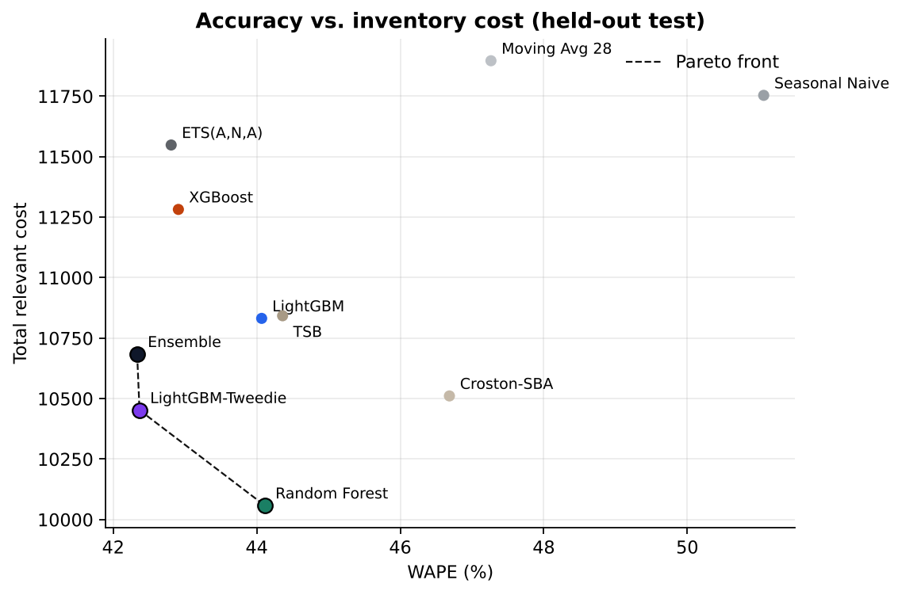
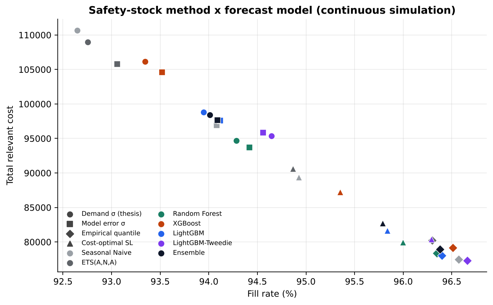
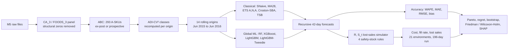
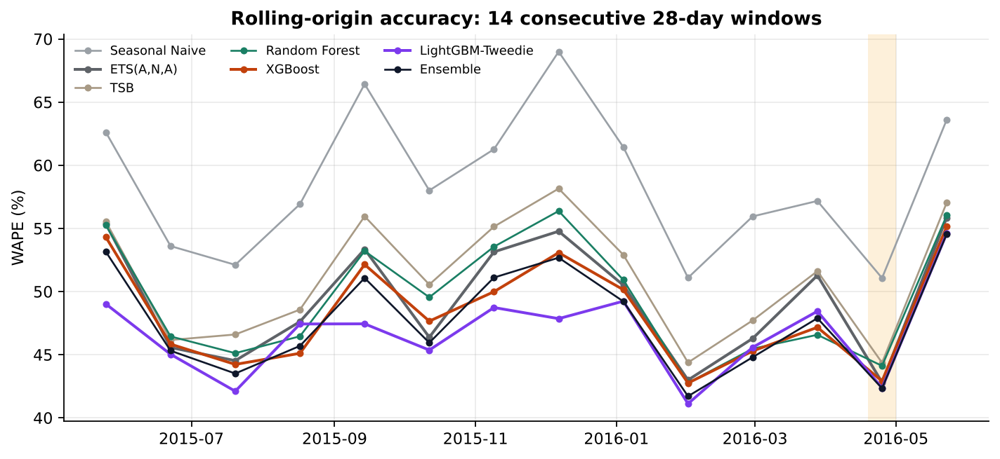
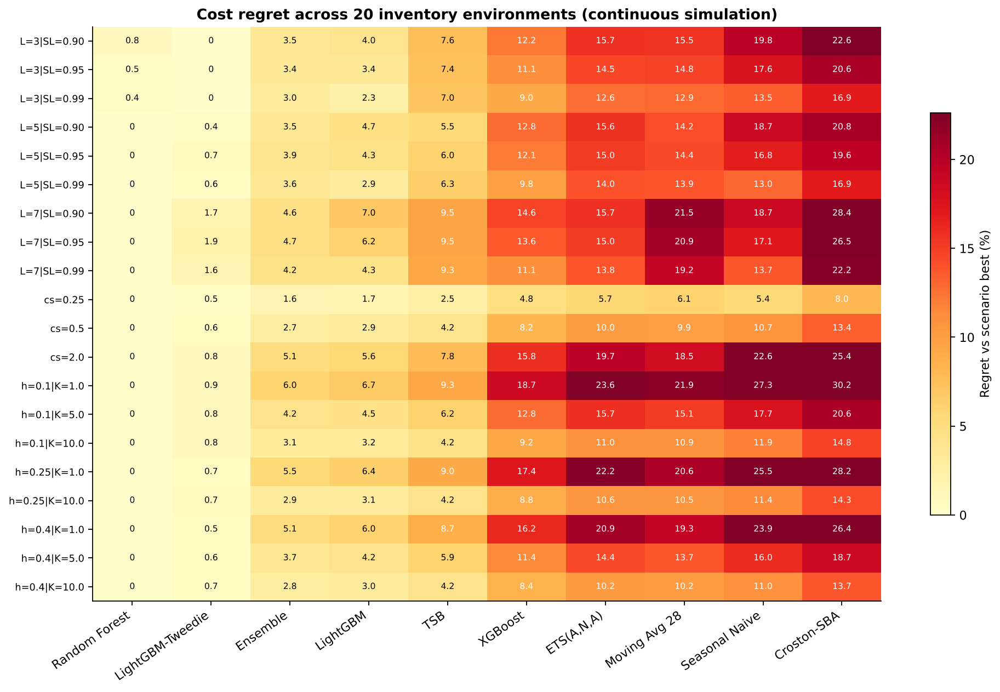

# Forecast → Inventory: does a more accurate forecast make a cheaper stock policy?

[](tests/)  

*[Türkçe özet → README.tr.md](README.tr.md)*

A leakage-safe, fully reproducible decision framework on the **M5 Walmart dataset** that scores
every demand-forecasting model twice: on **statistical accuracy** (WAPE, MAE, RMSE, bias) and on
the **operational result** it produces inside the same periodic-review inventory policy (total
cost, fill rate, lost sales).

This repository is a ground-up rebuild of my B.Sc. Industrial Engineering thesis (Istanbul Gedik
University, 2026). It reproduces the thesis results and then implements most of the thesis's own
"future work" list: a full year of rolling-origin backtests, intermittent-demand methods,
a count-aware LightGBM, an extra never-touched held-out window, a 196-day continuous inventory
simulation, distribution-free safety stock, a prospective (look-ahead-free) portfolio and a full
holding × ordering cost factorial.

Scope: Walmart store **CA_3**, department **FOODS_3**, the **293 A-class SKUs** that make up 80 %
of department revenue (525,957 SKU-days, Jan 2011 – Jun 2016).

---

## Key findings

| # | Finding | Evidence |
|---|---|---|
| 1 | **The most accurate model is not the cheapest one.** On the held-out test, XGBoost beats Random Forest on WAPE (42.9 % vs 44.1 %) but costs **12 % more** to run (11,282 vs 10,058). Random Forest's +9.6 % forecast bias holds extra stock, which is cheaper than the lost sales it prevents. | `reports/tables/pareto_test.csv`, SKU-cluster bootstrap 95 % CI of the cost gap: −2,069 … −605 |
| 2 | **Random Forest is the most robust cost choice.** Lowest cost in 18 of 21 inventory environments (lead time × service level × shortage cost × holding rate × order cost) in the long simulation, mean regret 0.09 %. | `regret_continuous.png` |
| 3 | **A count-aware LightGBM is the most accurate model over a full year.** LightGBM with Tweedie loss and native categorical item IDs wins 8 of 14 rolling windows (mean WAPE 46.7 % vs 48.3 % for XGBoost; Friedman p < 0.001, Wilcoxon-Holm vs every other model p < 0.05) and also sits on the accuracy-cost Pareto front. | `accuracy_rolling_summary.csv` |
| 4 | **How you size safety stock matters more than which model you pick.** In a 196-day warm-started simulation the textbook rule `z·σ·√H` under-delivers its 95 % target (fill 92.2–94.7 %), because 12-day forecast errors are ~1.5× larger than `σ·√H` assumes. A distribution-free rule at the same 95 % target (95th percentile of past H-day cumulative forecast errors) raises fill to 95.7–96.7 % **and cuts total cost by 18 %** (94.7k → 77.3k), while shrinking the cost spread between models from 20 % to 9 %. | `continuous_sim.csv`, `ss_methods_continuous.png` |
| 5 | **Segment-wise model picking from one validation window does not generalise.** The validation-selected demand-class hybrid (45.1 % WAPE) loses to single global models; the same rule rebuilt on a 3-window rolling history does no better (47.5 % vs 47.1 %). | `hybrid_rolling_rule.csv` |
| 6 | **The ex-post portfolio is not driving the result.** Re-selecting the A-class only with data available before the first forecast origin keeps 276 of 278 SKUs (Jaccard 0.94); the accuracy-vs-cost split persists. | `prospective_*.csv` |

<p align="center">
  
  
</p>

---

## Pipeline



**Leakage controls (all unit-tested in `tests/test_features.py`):**
- one feature function serves both training and recursive inference, so there is no train/serve skew;
- rolling statistics are `shift(1).rolling(w)` and need a full window;
- after the origin, lag/rolling features are built from the model's *own* forecasts; a test overwrites every future actual and checks that the forecast does not change;
- demand classes, safety-stock sigmas and error quantiles use only data before each origin; the continuous simulation uses, at each review, the forecast issued at the most recent origin.

---

## Results

### Forecast accuracy

| Model | Test WAPE<br/>(25 Apr – 22 May 2016) | Bias | Rolling mean WAPE<br/>(14 windows) | Window wins | M5 eval window WAPE<br/>(23 May – 19 Jun 2016) |
|---|---:|---:|---:|---:|---:|
| **LightGBM-Tweedie** *(new)* | 42.37 % | +3.9 % | **46.73 %** | **8** | 54.60 % |
| Ensemble (mean of 5) *(new)* | **42.33 %** | +4.9 % | 47.78 % | 4 | **54.56 %** |
| XGBoost | 42.91 % | +4.0 % | 48.26 % | 1 | 55.14 % |
| ETS(A,N,A) | 42.81 % | +0.8 % | 49.31 % | 0 | 55.85 % |
| Random Forest | 44.11 % | +9.6 % | 49.41 % | 1 | 56.03 % |
| LightGBM | 44.07 % | +6.0 % | 50.12 % | 0 | 55.48 % |
| TSB *(new)* | 44.36 % | +5.2 % | 51.05 % | 0 | 57.04 % |
| Moving Average 28 | 47.26 % | +5.8 % | 52.80 % | 0 | 58.32 % |
| Croston-SBA *(new)* | 46.68 % | 0.0 % | 53.09 % | 0 | 57.11 % |
| Seasonal Naive | 51.07 % | +0.4 % | 58.59 % | 0 | 63.61 % |



### Inventory outcome, held-out test (thesis protocol: R = 7, L = 5, 95 %, demand-σ safety stock)

| Model | Fill rate | Lost units | Total relevant cost | vs Seasonal Naive |
|---|---:|---:|---:|---:|
| **Random Forest** | **97.33 %** | **1,468** | **10,058** | **−14.4 %** |
| LightGBM-Tweedie | 96.97 % | 1,666 | 10,452 | −11.1 % |
| Ensemble | 96.91 % | 1,700 | 10,684 | −9.1 % |
| LightGBM | 96.86 % | 1,730 | 10,832 | −7.8 % |
| XGBoost | 96.64 % | 1,848 | 11,282 | −4.0 % |
| ETS(A,N,A) | 96.15 % | 2,120 | 11,548 | −1.7 % |
| Seasonal Naive | 96.36 % | 2,007 | 11,754 | — |

### 196-day continuous simulation (7 Dec 2015 – 19 Jun 2016, inventory carried across windows)

Total relevant cost by forecast model × safety-stock rule (lower is better):

| Model | Demand σ·√H (thesis) | Model error σ·√H | Cost-optimal SL (99.5 %) | **Empirical quantile** *(new)* |
|---|---:|---:|---:|---:|
| LightGBM-Tweedie | 95,391 | 95,867 | 80,395 | **77,320** |
| Random Forest | **94,707** | **93,715** | **79,929** | 78,379 |
| LightGBM | 98,813 | 97,616 | 81,643 | 78,033 |
| XGBoost | 106,159 | 104,625 | 87,217 | 79,165 |
| ETS(A,N,A) | 108,958 | 105,811 | 90,621 | 80,230 |
| Seasonal Naive | 110,659 | 96,922 | 89,400 | 77,492 |



### Explainability

TreeSHAP on 2,500 recursive test-horizon rows: `rolling_mean_7` (39.4 %) and `lag_1` (31.4 %)
carry 70.8 % of XGBoost's mean |SHAP|, followed by `rolling_mean_28`, `day_of_week` and `snap`.
SHAP values describe what the model uses; they are not causal effects.

### Agreement with the thesis

Same data, same portfolio (293 SKUs, 129 / 56 / 42 / 66 smooth / erratic / intermittent / lumpy),
same model settings. Seasonal Naive and MA-28 match the thesis exactly (MAE 3.428 / 3.173,
RMSE 5.855 / 5.674); the validation-selected hybrid picks the same model per class and lands
at 45.09 % (thesis 45.11 %); SHAP top-2 share 70.8 % (thesis 70.3 %); Random Forest is again the
cheapest model (10,058 vs thesis 10,001). The ML models differ by 0.1–0.5 WAPE points because the
re-implementation retrains on all data before the origin.

---

## Reproduce

```bash
pip install -r requirements.txt && pip install -e .
python scripts/download_data.py        # public M5 mirror, ~50 MB zip
python -m pytest -q                    # 25 tests, synthetic data, < 1 s
python scripts/run_all.py              # ~12 min on 2 CPU cores; writes reports/
python scripts/build_dashboard.py      # reports/dashboard.html, interactive results page
```

Every parameter lives in [`configs/default.toml`](configs/default.toml). Change the store,
department, horizon, policy or sensitivity grid there and re-run; forecasts are cached in
`data/cache/` so policy experiments re-run in seconds.

## Repository layout

```
src/forecast_inventory/
  data.py           M5 loading, activity detection, dense SKU x day panel
  segmentation.py   ABC (revenue) and ADI-CV² demand classes
  features.py       one leakage-safe feature function for training and inference
  models/           baselines.py (vectorised ETS, Croston-SBA, TSB, ...) and ml.py (global trees, recursion)
  backtest.py       rolling-origin engine + TreeSHAP
  inventory.py      (R, S_t) lost-sales simulator, four safety-stock rules
  experiments.py    accuracy, hybrids, sensitivity, regret, Pareto, bootstrap, rank tests
  plots.py          report figures
scripts/            download_data.py, run_all.py, build_dashboard.py
tests/              leakage, simulator hand-calculations, baselines, metrics
reports/            tables/*.csv, figures/*.png, results.json, dashboard.html (all committed)
docs/               methodology.md
```

## Limitations

- Costs are scenario costs: M5 has no purchase cost, margin, lead time or holding rate, so the
  selling price is the monetary proxy and all results are comparative.
- One store-department. Results are conditional on the CA_3 / FOODS_3 A-class portfolio.
- Long zero-sales runs in M5 are partly supply-side (censored demand); the simulator treats
  recorded sales as demand.
- The empirical-quantile rule pools errors within demand classes; with very few past windows it
  falls back to the demand-σ rule.

## Data and references

Makridakis, Spiliotis & Assimakopoulos (2022), *The M5 competition: background, organization and
implementation*, IJF. Data: [Kaggle M5 Forecasting – Accuracy](https://www.kaggle.com/competitions/m5-forecasting-accuracy).
Theodorou, Spiliotis & Assimakopoulos (2025) on forecast accuracy vs inventory performance;
Syntetos, Boylan & Croston (2005) on demand classification; Teunter, Syntetos & Babai (2011) on TSB.
